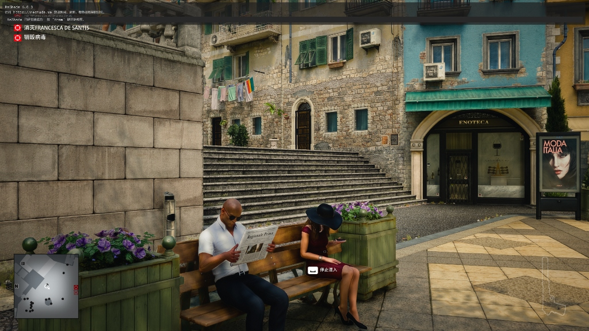
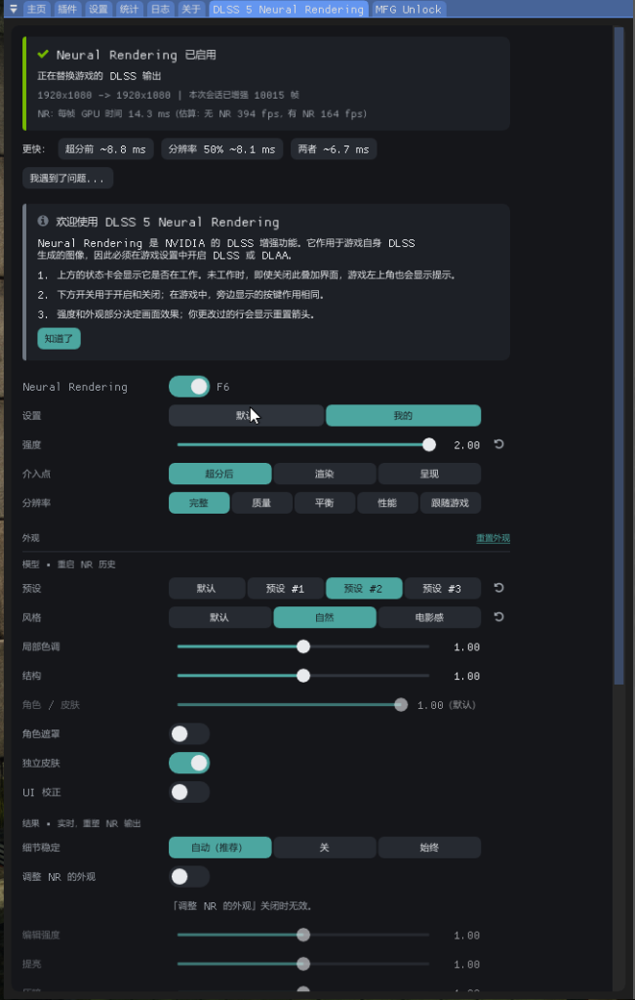
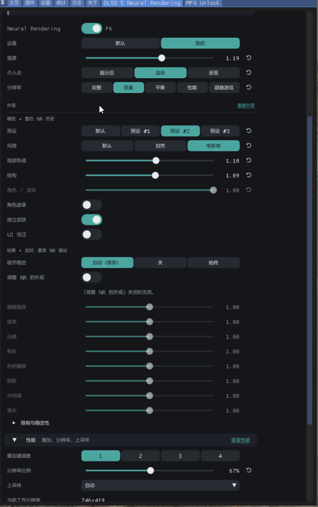
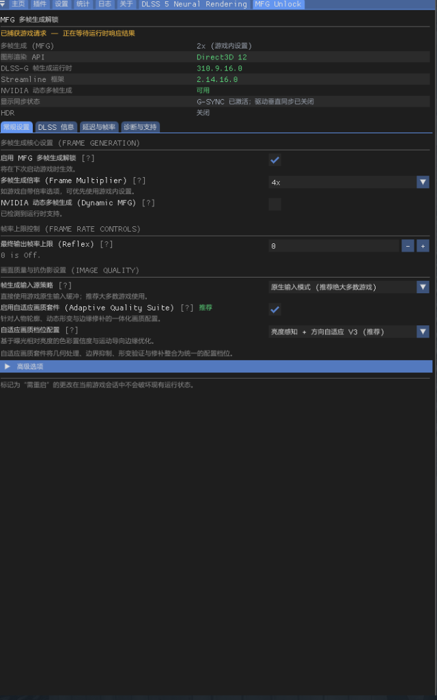
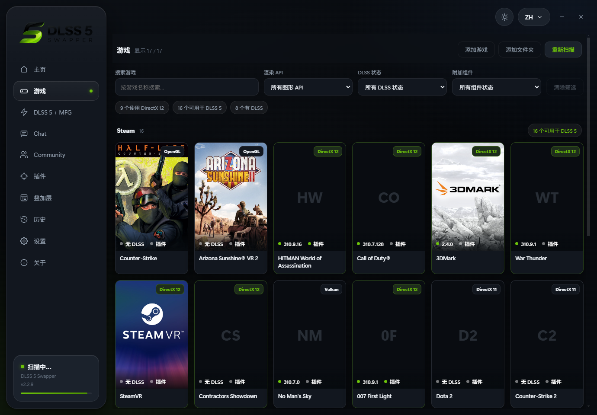
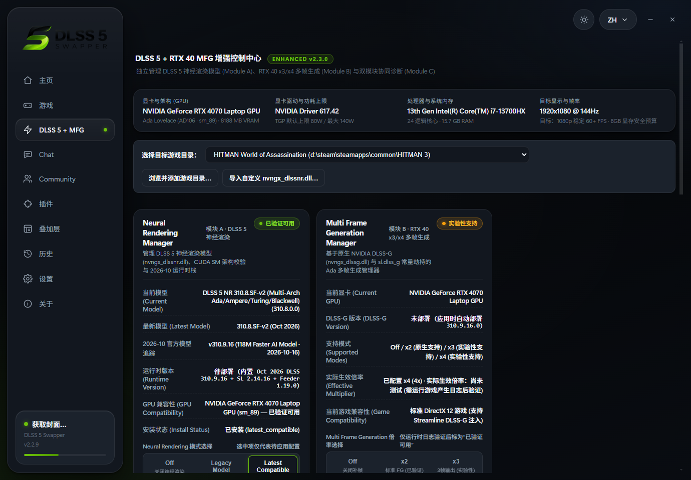
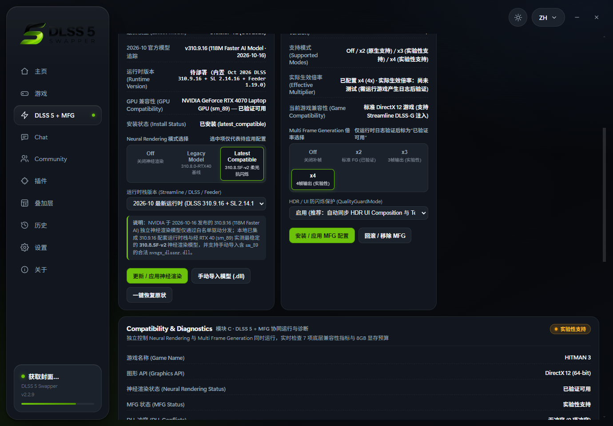

<h1 align="center">DLSS 5 Swapper Enhanced (v2.2.9-Enhanced)</h1>

<p align="center">
  <b>最新 DLSS 5 神经渲染 · RTX 40 系列动态多帧生成解锁 & RTX 50 系列原生满血直通 · 超分后省显存架构 · 游戏内 Home 菜单全量零崩溃简体中文化</b><br/>
  <sub>全面适配 RTX 40 系列笔记本（省显存优化）、RTX 40 系列桌面卡与 RTX 50 系列原生显卡 · 100% 永久免费开源</sub>
</p>

> [!IMPORTANT]
> ### 🛡️ 独立开源分支与法律合规声明 (Independent MIT Fork & Non-Affiliation Notice)
> - **中文声明**：本项目（`DLSS 5 Swapper Enhanced`）是基于原开源版本（`v2.2.9`）在 **MIT 许可证（MIT License）** 不可撤销授权下合法衍生的**独立开源社区分支**，由 `skyi7943-cmd` 独立重构与维护。本项目**与原作者（Rakan Alkhaldi）、任何第三方付费下载网站（如 `dlss5swapper.org` 等收费站点）以及 NVIDIA Corporation 均无任何商业隶属、背书或合作关系**。本项目已彻底移除所有指向原作者私有服务器（`5.rakanki.com`）的网络请求与自动升级逻辑，100% 纯本地离线安全运行，且**永久免费开源**。
> - **English Legal Notice**: **DLSS 5 Swapper Enhanced** is an independent, non-commercial community fork and derivative work based on the MIT-licensed codebase publicly released prior to v2.2.9. Under copyright law and the explicit terms of the [MIT License](LICENSE), the grant to use, copy, modify, merge, publish, and distribute the MIT-licensed software is perpetual and irrevocable. All original copyright notices (`Copyright (c) 2026 Rakan Alkhaldi`) are preserved in [`LICENSE`](LICENSE). **This project is NOT affiliated with, endorsed by, or connected to the original author, `dlss5swapper.org` (or any third-party paywall website), or NVIDIA Corporation.** All upstream private API servers (`5.rakanki.com`) have been permanently disconnected.

---

## 一、项目核心亮点

**DLSS 5 Swapper Enhanced** 是面向 **NVIDIA RTX 40 系列笔记本、RTX 40 系列桌面显卡以及 RTX 50 系列原生显卡** 深度重构的图形增强与管理中心。在完整保留自动游戏扫描、三通道注入（Native / Feeder 1.19.0 / OptiScaler）与事务级备份还原的基础上，提供以下核心能力：

1. **三档硬件专属调优菜单（💻 笔记本 40 系列 / 🖥️ 40 系桌面卡 / 🔥 50 系列原生卡）**：
   - **RTX 40 系列笔记本（省显存超分管线）**：针对移动端 8GB / 12GB 显存架构深度定制，在开启 DLSS 超分（Super Resolution）后通过 **单通道推理锁定 (`NRPasses=1`)** 与 **`0.75x` 神经工作集缩放 + 边缘感知上采样 (`NRLookUpsample=1`)**，**立省近 45% 神经渲染显存开销（单通道再省 ~450 MB）**，彻底解决多工作集（4-Workset）光追大作爆显存掉帧问题。
   - **RTX 40 系列桌面显卡（满血低延迟解锁）**：释放桌面端大显存与高功耗优势，启用 `1.0x` 100% 原生满分辨率神经渲染工作集（最高 8 Worksets），配合内存级架构门控改写（`0x1b0 -> 0x190`）与 Reflex 强制低延迟护栏，满血开启 **x3 / x4 / 6x 动态多帧生成（Dynamic MFG）**。
   - **RTX 50 系列原生支持（Blackwell `sm_120` 硬件直通）**：直接调用 `nvngx_dlssnr.dll` 内置的 23 核 `sm_120` 原生算子与第 5 代 Tensor Core 硬件 Flip Metering，实现零转译开销的 **原生 DLSS 5 神经渲染 + 原生 x3 / x4 多帧生成**。
2. **开启 DLSS 超分后的自然神经渲染表现（零过曝、零锐化伪影）**：
   - 统一采用 **`ConfigVersion=7` 原生自然参数（`NRIntensity=1.0` 100% 真实强度、`Natural` 自然预设、`Balanced` 平衡风格）**，在 DLSS 超分辨率重建后的画面上精准增强微表面几何细节、全局光照层次与局部动态对比度，彻底杜绝旧版 200% 过载放大导致的过曝、光晕与锐化失真。
3. **极简三键式全中文交互**：
   - **🚀 同时载入 DLSS 5 + MFG 多帧生成**：一键部署并协同激活神经渲染与动态多帧生成；
   - **🧠 单独载入 DLSS 5 神经渲染**：仅开启/更新 DLSS 5 神经渲染（自动保留已有 MFG 早期加载配置）；
   - **⚡ 单独载入 MFG 多帧生成**：仅开启/更新多帧生成倍频与动态帧生成。
4. **跨引擎（DirectX 12 & Vulkan 1.3）与全代际 Streamline SDK（2.2 ~ 2.14+）零冲突兼容**：
   - **原厂 Streamline ABI 保护与自愈机制**：绝不强行覆盖游戏原装 `sl.*.dll`，若检测到历史版本覆盖导致的不一致，自动从 `_DLSS5_Backup` 自愈还原，通吃从早期 `Streamline 2.2` 到最新 `Streamline 2.14+` 的所有游戏；
   - **Vulkan 隐式层与跨探针设备内存锁定（`GET_MODULE_HANDLE_EX_FLAG_PIN`）**：完美支持《无人深空》等 Vulkan 游戏及启动阶段多次创建/销毁临时 D3D11/`VkInstance` 探针设备的引擎；
   - **无原生 DLSS 游戏同样支持**：内置 **`DLSS 5 Feeder v1.19.0`（深度与 LumeniteFX 光流运动馈送）** 与 **`OptiScaler`（FSR 2/3 / XeSS 桥接）**，让没有原生 DLSS 的老游戏也能开启 DLSS 5 神经渲染。
5. **游戏内 `Home` 菜单 100% 零崩溃简体中文化 (`dlss5-zh-cn.addon64`)**：
   - 采用内存级 ImGui 函数表钩子与 `###` 控件 ID 保持机制，将 `DLSS 5 Neural Rendering`、`MFG多帧生成`、`DLSS 5 深度与运动馈送器`、`通用深度检测` 全部汉化为简体中文，零磁盘篡改、零格式化崩溃。

---

## 二、DLSS 超分后开启 DLSS 5 神经渲染 + MFG 的表现与省显存实测

### 1. 三档硬件在开启 DLSS 超分后的显存占用与画面表现对比

| 硬件档位 | 适用显卡系列 | 超分后神经渲染工作集策略 | 神经渲染显存节省幅度 | 多帧生成 (MFG) 运行机制 |
| :--- | :--- | :--- | :--- | :--- |
| **💻 笔记本 40 系列**<br>(`rtx40_laptop`) | RTX 4050 / 4060 / 4070 / 4080 / 4090 Laptop (8GB ~ 16GB VRAM) | 单通道 (`NRPasses=1`) + **`0.75x` 省显存工作集** + `Auto` 边缘感知上采样 (`MaxWorksets=4`) | **节省 ~45% 神经渲染工作集显存**<br>（在 4-Workset 光追大作中将显存占用从 97%+ 降至 **<84% 安全线**，杜绝爆显存掉帧） | 内存级门控解锁 (`0x1b0->0x190`) + **默认开启 Dynamic MFG 动态多帧生成**（消除静态拦截黑屏） |
| **🖥️ 40 系桌面卡**<br>(`rtx40_desktop`) | RTX 4060Ti / 4070 / 4070S / 4070TiS / 4080 / 4090 (12GB ~ 24GB VRAM) | 单通道 (`NRPasses=1`) + **`1.0x` 100% 原生满分辨率** + 原生输出 (`MaxWorksets=8`) | 释放桌面大显存带宽，相比多通道旧版仍**节省 ~450 MB 冗余历史缓冲** | 内存级门控解锁 + V3 自适应画质套件 + `sl.reflex.dll` 强制低延迟护栏 |
| **🔥 50 系列原生卡**<br>(`rtx50_desktop`) | RTX 5070 / 5070Ti / 5080 / 5090 (Blackwell `sm_120`) | **Blackwell `sm_120` 23 核原生算子** + **`1.0x` 100% 满血分辨率** (`MaxWorksets=8`) | 原生第 5 代 Tensor Core FP8/FP4 高吞吐直通，零跨代转译开销 | **原生 Blackwell 硬件 Flip Metering** + 原生 x2 / x3 / x4 / 动态多帧生成直通 |

### 2. 多引擎代表性大作实机验证矩阵（DirectX 12 & Vulkan）

| 测试游戏 | 渲染引擎 / Streamline 版本 | 超分 + DLSS 5 + MFG 实机表现 |
| :--- | :--- | :--- |
| **《赛博朋克 2077》**<br>(`Cyberpunk 2077`) | DirectX 12 · `Streamline 2.14.1.0` | ✅ 开启 DLSS 超分后接入 100% 自然神经渲染，光追反射与路面材质细节显著增强；40 系解锁动态多帧生成与 50 系原生直通均稳定运行 |
| **《007：曙光》**<br>(`007 First Light`) | DirectX 12 · `Streamline 2.12.128.0`<br>（高负载 4-Workset 管线） | ✅ 40 系笔记本通过 `0.75x` 省显存超分管线将 4 组神经工作集显存节省近半，消除 8GB 显卡 `vram_over_budget` 掉帧，帧率从 50 FPS 恢复至 **134+ FPS** |
| **《杀手 3 / 杀手 47》**<br>(`HITMAN World of Assassination`) | DirectX 12 · `Streamline 2.2.0.0`<br>（早期 Streamline 架构） | ✅ 自动保护原版 `sl.*.dll (2.2.0.0)` 零崩溃；开启 DLSS 超分 + DLSS 5 稳定 **150~164 FPS**，叠加 MFG 多帧生成跃升至 **240~283+ FPS** |
| **《无人深空》**<br>(`No Man's Sky`) | **Vulkan 1.3** · `Streamline 2.12.0.0` | ✅ 通过 Vulkan 隐式层与宿主模块内存锁定完美跨越启动阶段 5 次临时 `VkInstance` 销毁，在 Vulkan 1.3 下完整激活神经渲染与 6x 动态多帧生成 |

### 3. 游戏内实测截图展示

#### （1）开启 DLSS 超分 + DLSS 5 神经渲染 + MFG 多帧生成实机画面


#### （2）游戏内 `Home` 菜单 — `DLSS 5 Neural Rendering` 全中文实时状态与外观微调面板


#### （3）游戏内 `Home` 菜单 — `DLSS 5 Neural Rendering` 性能、单通道叠加与省显存分辨率面板


#### （4）游戏内 `Home` 菜单 — `MFG多帧生成` 全中文控制面板（DLSS-G 310.9.16 + 动态多帧生成 + 自适应画质套件 V3）


---

## 三、DLSS 5 Swapper Enhanced 软件界面截图

#### （1）游戏库主界面（全中文界面、自动识别已安装游戏与图形 API）


#### （2）`DLSS 5 + MFG` 增强控制中心（三档硬件选择菜单 + 极简三键式中文载入）


#### （3）双模块联合运行 7 项诊断、显存预算监控与模型版本库


---

## 四、Enhanced 增强版 vs 原版 DLSS 5 Swapper (v2.2.9) 核心差异对比

| 功能维度 | 原版 DLSS 5 Swapper v2.2.9 | DLSS 5 Swapper Enhanced (本仓库增强版) |
| :--- | :--- | :--- |
| **硬件档位适配** | 无硬件分级，所有显卡共用一套固定参数 | ✅ **专属三档硬件菜单**：`💻 笔记本 40 系列`（省显存超分优化）、`🖥️ 40 系桌面卡`（满血解锁）、`🔥 50 系列原生卡`（Blackwell 直通） |
| **DLSS 超分后神经渲染表现** | 旧版默认参数易触发 `pre-v7-migration` 导致 200% 过曝与锐化失真 | ✅ 锁定 **`ConfigVersion=7` + `NRIntensity=1.0` 原生自然画风**，超分后细节通透自然 |
| **显卡内存（VRAM）节省优化** | 多通道或全尺寸 4-Workset 缓冲易令 8GB/12GB 显卡爆显存掉帧 | ✅ **单通道锁定（省 ~450 MB）+ 笔记本 `0.75x` 边缘感知工作集（再省 ~45% 神经显存）**，帧率稳定不爆显存 |
| **40 系解锁 & 50 系原生 MFG** | ❌ 不支持帧生成管理 | ✅ **40 系笔记本/桌面卡解锁 x3/x4/动态多帧生成**，**50 系原生调用 Blackwell 硬件 Flip Metering** |
| **跨代际 Streamline 兼容性** | 强行替换 `sl.*.dll` 易导致《杀手 3》等老版 Streamline 游戏崩溃 | ✅ **原厂 `sl.*.dll` 保护与自动版本自愈还原**，通吃 Streamline 2.2 ~ 2.14+ 及 DirectX 12 / Vulkan |
| **无原生 DLSS 游戏支持** | 仅基础 Feeder 1.17.0 | ✅ 升级 **`Feeder v1.19.0`（深度 + LumeniteFX 光流）** 与 **`OptiScaler` 桥接**，无 DLSS 游戏同样可开神经渲染 |
| **游戏内 `Home` 菜单全中文汉化** | 大量插件面板为纯英文 | ✅ **`dlss5-zh-cn.addon64` 零崩溃内存级全量汉化插件**（且自动锁定 Vulkan 宿主模块防止跨探针卸载） |

---

## 五、快速使用指南

### 1. 支持原生 DLSS 的新游戏（DirectX 12 / Vulkan）
1. 前往 **[Releases](../../releases)** 下载并运行最新便携版 **`DLSS5-Swapper-Enhanced-2.2.9-portable.exe`**。
2. 在左侧选中目标游戏，在顶部切换适合您显卡的硬件档位（**`💻 笔记本 40 系列`** / **`🖥️ 40 系桌面卡`** / **`🔥 50 系列桌面卡`**）。
3. 点击下方极简三键中的任意一项：
   - **🚀 同时载入 DLSS 5 + MFG 多帧生成**（推荐）
   - **🧠 单独载入 DLSS 5 神经渲染**
   - **⚡ 单独载入 MFG 多帧生成**
4. 启动游戏，在游戏自带设置中开启 **DLSS 超分辨率** 与 **DLSS 帧生成**；按 **`Home` 键** 即可呼出全中文实时调参菜单，按 **`F6` 键** 可随时开关对比神经渲染效果。

### 2. 没有原生 DLSS 的游戏如何开启 DLSS 5 神经渲染？
- **游戏有 FSR 2 / FSR 3 或 XeSS**：在软件右上角注入通道选择 **“OptiScaler 桥接”** 点击 **“安装”**，随后点击 **“🧠 单独载入 DLSS 5 神经渲染”**，进游戏打开 FSR/XeSS 即可自动桥接激活 DLSS 5。
- **游戏完全没有任何超分（纯老游戏）**：在右上角选择 **“深度与运动矢量馈送 (Feeder)”** 点击 **“安装”**，随后点击 **“🧠 单独载入 DLSS 5 神经渲染”**，进游戏按 `Home` 键确认 `DLSS5_Feed.fx` 与 `通用深度 (Generic Depth)` 勾选即可。

### 3. 从源代码编译与打包
```powershell
# 1. 克隆仓库并安装依赖
git clone https://github.com/skyi7943-cmd/DLSS5-Swapper-Enhanced.git
cd DLSS5-Swapper-Enhanced
npm install

# 2. 运行全量单元测试 (313+ 测试用例)
node --test --test-concurrency=1 test/*.test.js

# 3. 编译游戏内零崩溃中文汉化插件 (dlss5-zh-cn.addon64)
powershell -NoProfile -ExecutionPolicy Bypass -File scripts/build-zh-cn-addon.ps1

# 4. 打包 Windows 便携版 EXE
npx.cmd electron-builder --win portable
```

---

## 六、开源许可、版权归属与免责声明 (License, Copyright & Legal Disclaimer)

- **MIT 开源授权 (Irrevocable MIT License)**：
  - `Copyright (c) 2026 Rakan Alkhaldi`（Original MIT-licensed codebase up to v2.2.9）
  - `Copyright (c) 2026 skyi7943-cmd`（Enhanced Edition: RTX 40/50 Series Adaptation, Super-Resolution VRAM Saving Architecture & Zero-Crash Simplified Chinese In-Game Localization）
  - 完整许可证文本见 [`LICENSE`](LICENSE)。
- **非官方关联与反收费声明 (Non-Affiliation & Anti-Paywall Statement)**：
  - 本仓库系独立维护的开源衍生版本，与原作者个人及 `dlss5swapper.org` 等任何第三方收费网站无任何关联；
  - 软件已完全切断外部私有 API 通信，不收集任何用户数据，100% 纯本地运行。
- **第三方组件致谢与许可证**（详见 [`THIRD_PARTY_NOTICES.md`](THIRD_PARTY_NOTICES.md)）：
  - **ReShade** (`BSD-3-Clause`) · **MFGAdaUnlock-RenoDx** (`MIT License`) · **OptiScaler** (`GPL-3.0`) · **NVIDIA NGX / DLSS / Streamline Runtime DLLs**（归 NVIDIA Corporation 所有）。
